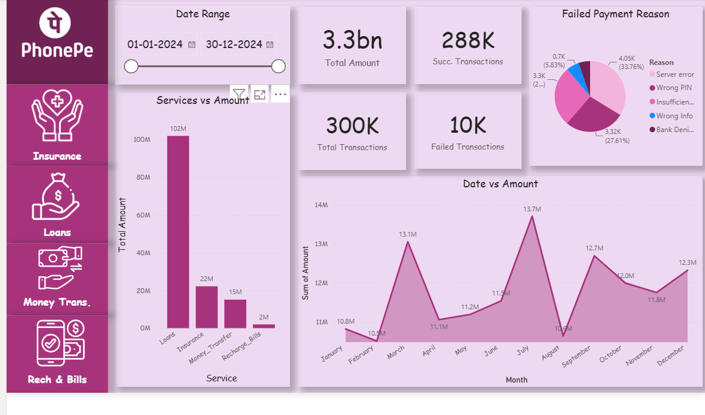
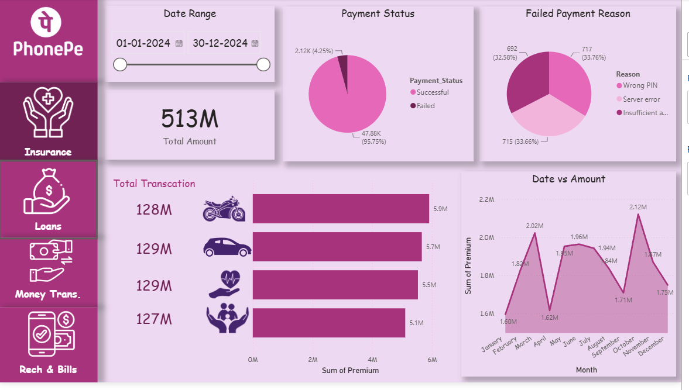
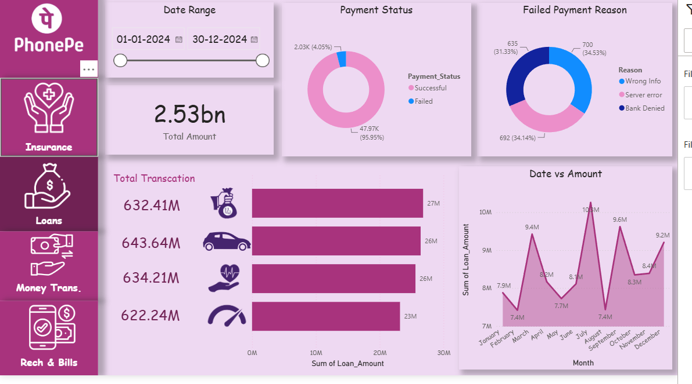
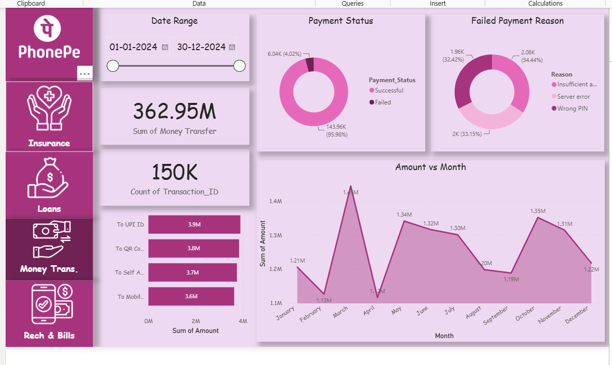
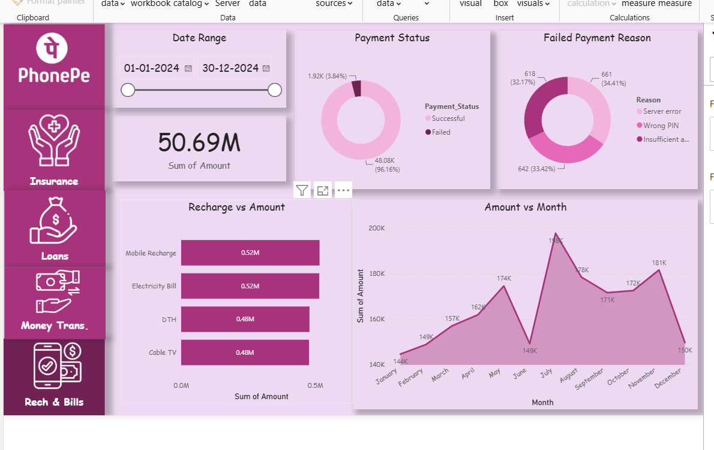

# PhonePe Transaction Analysis Using Excel and Power BI

An interactive dashboard and business case study analysing 300,000 digital payment transactions across four services: Money Transfer, Loans, Insurance, and Recharge & Bills.

## Dashboard Preview

**Overview**


**Insurance**


**Loans**


**Money Transfer**


**Recharge & Bills**


## Project Overview

Digital payment data is spread across several service tables, which makes it hard to see payment success and failure patterns, the value handled by each service, and the reasons payments fail. This project cleans the dataset in Excel, models it in Power BI, and presents the results in a five-page interactive dashboard with KPI cards and breakdowns.

## Business Questions

1. How many transactions succeed or fail, by service?
2. What is the total transaction value for each service?
3. Why do transactions fail, and what share does each reason account for?
4. Which services carry the most volume and value?
5. How can stakeholders monitor these KPIs without manual analysis?

## Dataset

| Sheet | Rows | Description |
|---|---|---|
| All_Users | 107,658 | User_ID, Name, Age, Join_Date |
| All_Transactions | 300,000 | Master transaction table across all services |
| Money_Transfer | 150,000 | Transfer type, amount, payment status, reason |
| Loans | 50,000 | Loan type, loan amount, payment status, reason |
| Insurance | 50,000 | Insurance type, premium, payment status, reason |
| Recharge_Bills | 50,000 | Recharge type, amount, payment status, reason |

- **Period:** 1 January to 30 December 2024
- **Source:** Analyst-prepared dataset. It is not verified as official PhonePe data and should be treated as a sample for portfolio use.

## Data Cleaning

1. Imported and inspected all six sheets (columns, data types, row counts).
2. Checked every column for missing values: none found.
3. Checked for duplicate records: none found.
4. Confirmed Transaction_ID is unique and that all service-sheet IDs exist in All_Transactions.
5. Standardised date fields as dates and amounts as numeric values.

## Tools and Technologies

- **Microsoft Excel:** data inspection, cleaning, and preprocessing
- **Power Query:** data transformation
- **Power BI Desktop:** data modelling and dashboard design
- **DAX:** calculated measures for KPIs
- **Slicers, cards, and charts:** interactive filtering and visual analysis

## Dashboard Pages

The dashboard has five pages, navigated from a left-hand panel, with a date range slicer:

- **Overview:** total amount, successful and failed KPIs, failure reasons, service value
- **Insurance:** total premium, payment status, premium by insurance type
- **Loans:** total loan amount, payment status, value by loan type
- **Money Transfer:** total transfer value, transaction count, payment status, failure reasons, transfer type
- **Recharge & Bills:** total amount, payment status, failure reasons, value by recharge type

## Key KPIs

| KPI | Result |
|---|---|
| Total transactions | 300K |
| Successful transactions | 288K |
| Failed transactions | 10K |
| Total amount (overall) | 3.3bn |
| Success rate | About 96% |

## Service-Level Results

| Service | Transactions | Value shown on dashboard | Success rate |
|---|---|---|---|
| Money Transfer | 150K | 362.95M | 95.98% |
| Loans | 50K | 2.53bn | 95.95% |
| Insurance | 50K | 513M | 95.75% |
| Recharge & Bills | 50K | 50.69M | 96.16% |

## Key Findings

- Success rate is consistent at about 96% across all four services.
- Money Transfer accounts for half of all transactions and the highest failure count (6.04K).
- Loans hold the largest transaction value (2.53bn).
- Failure reasons split roughly one-third each within every service.
- Server errors appear in every service and may point to a platform reliability issue (hypothesis, requires investigation).

## Recommendations

| Priority | Action | Metric to monitor |
|---|---|---|
| High | Investigate server errors with the technical team | Server-error share of failures |
| High | Review failed Money Transfer flows and retry paths | Money Transfer success rate |
| Medium | Add pre-payment prompts for Wrong PIN and insufficient balance | Failure rate by reason |
| Medium | Track loan success rate and value monthly | Loan value and success rate |
| Low | Schedule regular dashboard refresh | Refresh timeliness |

## Limitations

- Dataset provenance is not verified as official PhonePe data.
- Covers 2024 only.
- Some dashboard cards show successful-only values, others show all statuses.
- Payment-status labels differ between the master and Money Transfer tables for some records; to be reconciled.
- Monthly trend analysis is pending reconciliation of dashboard visuals with source data.

## Future Enhancements

- Reconcile dashboard visuals with source data and document the logic
- Automated data refresh
- Monthly trend analysis once validated
- Anomaly detection for unusual transaction patterns
- User segmentation by age and join date

## Repository Contents

```
├── README.md
├── PhonePe_Transaction_Analysis_Report.pptx
└── images/
    ├── dashboard-overview.png
    ├── dashboard-insurance.png
    ├── dashboard-loans.png
    ├── dashboard-money-transfer.png
    └── dashboard-recharge-bills.png
```

## Skills Demonstrated

Excel data cleaning and validation · Power BI data modelling · DAX measures · Interactive dashboard design · KPI definition · Business interpretation · Communicating recommendations
